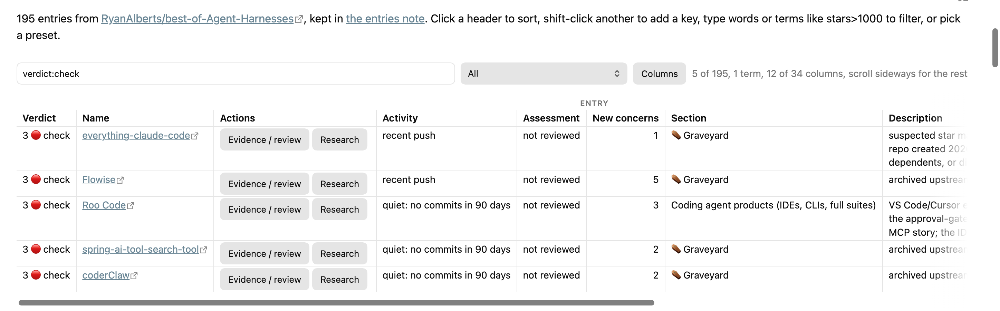
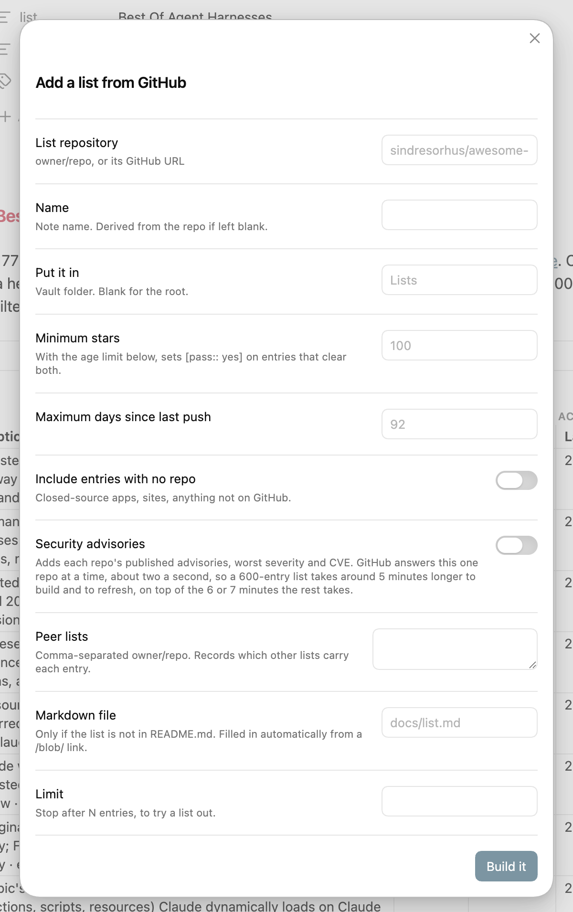

# Listkeeper

Point Listkeeper at any awesome list or best-of list on GitHub and get a table in your vault that shows which projects are alive, which carry published security advisories, and which ones the list itself has quietly dropped.

[](LICENSE)


An awesome list is a snapshot. The repositories behind it keep moving: some get archived, some pick up CVEs, some stop merging pull requests while their stars keep climbing. Listkeeper reads the list, asks GitHub about every repository in it, and keeps the answers in two notes that stay current on a schedule.

- **A verdict with evidence.** Every row gets `ok`, `caution`, `check` or `unknown` from documented rules: archived, dropped by the source, deprecated in the source text, published advisories, an untouched issue backlog, a non-standard licence. One tap shows the facts behind it and records your own dated assessment next to them.
- **Security advisories, not only stars.** With a token, each repository's published advisories arrive with severity and affected and patched version ranges.
- **Whole lists in two notes.** A list of 1,000 projects is one view note and one entries note, not 1,000 files. The entries note keeps every value in inline fields that Dataview can read.
- **Your edits survive refreshes.** Edited descriptions, your own headings and sub-bullets stay where you put them. A sync shows what the source list changed and lets you accept or dismiss it per entry.
- **Star movement two ways.** Additions over the last four completed GitHub weeks on the first run, and a local net change once a sample between 20 and 60 days old exists.
- **Light footprint.** No build step, no runtime dependency, no telemetry. It works on mobile, needs no token for the basics, and resumes an interrupted run after a reload.

## How it compares

The GitHub plugins already in the directory solve narrower jobs: GitHub Stars shows star counts for links in a note, Import GitHub Readme brings one README into the vault, GitHub Repo Tools watches one repository, GitHub Stars Manager handles the repositories you starred yourself, and GitHub Embeds renders a single issue or pull request. Listkeeper starts from someone else's curated list, covers every repository in it at once, judges each one by the same rules, and keeps judging as the list and the repositories change. It talks to GitHub and to nothing else.

The verdict is a review aid, not a security guarantee or an installation recommendation.

## Using the table

The filter accepts words, quoted phrases, and field comparisons. For example:

```text
verdict:check
stars>1000 lang:rust pushed>2026-06-01
-lic:noassertion
"local model"
```

All active terms must match a row. A leading `-` excludes matches.



Up to 14 columns are selected by default. A column appears only when at least one entry contains that field. Use **Columns**, or right-click the header row, to change the selection. Hidden columns can still be used in filters.

When you add a list, you can set the source repository, note name, vault folder, minimum star count, maximum age of the last push, software or reference-list expectations, advisory collection, peer lists, Markdown file, and an optional entry limit.

Tap **Evidence / review** in the Actions column to see automatic concerns, check dates, advisory links and version ranges, and save a dated assessment with your reason. Your assessment acknowledges the current concerns; new findings are counted separately. Quiet activity alone does not require a review. The same action exposes source-description and section conflicts with **Accept** and **Dismiss** buttons.

Tap **Research** to create a note only for the selected project, or reopen its explicitly attached research link. Your research note contains a repository link and an editable heading; fetched metadata remains in the entries note.



On a narrow screen, the table scrolls horizontally while the Verdict and Name columns remain visible. The screenshots use the Minimal theme.

## Network use and accounts

Listkeeper connects to two GitHub hosts and to nothing else:

- `raw.githubusercontent.com` serves the source list's Markdown and the READMEs of any peer lists you configure.
- `api.github.com` serves repository metadata (REST without a token, GraphQL with one), star history, published security advisories when a list has them enabled, and token validation.

Requests run when you add, refresh, or sync a list, and on the schedule you choose. The plugin sends no telemetry and reads no files outside the vault.

A GitHub account is optional. Without a token, Listkeeper uses GitHub's unauthenticated limits and a per-run request allowance, and the activity fields that need GraphQL remain empty. A fine-grained token with read access to public repository metadata provides the full field set and higher limits. The token is stored in the plugin's `data.json` inside the vault and is sent only to `api.github.com`.

## Installation

Listkeeper needs Obsidian 1.13.0 or later. Install it with BRAT or from the GitHub release:

**With BRAT:** install BRAT, run **Add a beta plugin for testing**, and enter `amoslives/listkeeper`. BRAT downloads the latest Listkeeper release and handles later updates.

**Manually:** download `main.js`, `manifest.json`, and `styles.css` from the latest GitHub release. Copy them into `<vault>/.obsidian/plugins/listkeeper/`, restart Obsidian, and enable Listkeeper under **Settings > Community plugins**.

## Quick start

1. Open **Settings > Listkeeper**, follow **Create a GitHub token**, enter a fine-grained token, and select **Validate token**. For public repositories, Listkeeper only needs read access to public repository metadata; it does not need write access.
2. Run **Add a list from GitHub** from the command palette.
3. Enter `owner/repository`, a GitHub repository URL, a URL with a heading anchor, or a `/blob/` link to a Markdown file.
4. Open the generated view note. Click a header to sort, Shift-click another header to add a second sort key, type in the filter box, or select a preset.
5. If required, open **Settings > Listkeeper** and choose a daily or weekly schedule. Reload Obsidian after changing the schedule.

The token is optional. Every recognized GitHub entry within the selected import limit is saved, including entries awaiting metadata. Without a token, one allowance (55 requests by default) covers repository data, star history, and advisory pages across all lists in a run. Unattempted work goes first, followed by the least recently attempted work. Progress survives reloads and failed requests; GitHub rate-limit headers can pause the run until reset. A token provides the full activity fields and a higher rate limit.

The token is stored in the plugin's `data.json` file inside the vault. Do not publish or share that file.

Star history is cached for 24 hours. Advisory collection adds a request per page per repository, so enabling it takes more requests and time.

## Commands

| Command | What it does |
|---|---|
| Add a list from GitHub | It reads the source Markdown, fetches repository data, creates the view and entries notes, saves the first star-count sample, and opens the view note. |
| Refresh every list | It updates GitHub-derived fields and star history for every managed list. It does not read the source list again. |
| Sync every list with its source | It reads each source list again, adds newly listed GitHub repositories, marks missing repositories as delisted, and then refreshes repository data. It updates untouched descriptions and sections; local edits are preserved and conflicting source changes can be accepted or dismissed. |
| Rescan peer lists | It recalculates how many configured peer lists contain each repository and then refreshes repository data. |
| Refresh one list | It lets you choose one managed list, then syncs it, rescans its peer lists, and refreshes its repository data. |
| Convert a folder of notes into a list | It copies supported frontmatter fields into the two-note format and keeps originals by default. You can choose to trash only the converted notes after the new notes are written. Note bodies and custom properties are not copied. |

The ribbon button syncs, rescans, and refreshes every managed list.

## Presets

Some presets appear only when the required field exists in the entries note.

| Preset | What it shows |
|---|---|
| All | It shows every entry and sorts them by stars in descending order. |
| Best bets, ok with high criticality | It shows entries with an `ok` verdict, a partial OpenSSF criticality score of at least 0.7, and no high or critical advisory. |
| Check before installing | It shows entries with a `check` verdict. |
| Caution | It shows entries with a `caution` verdict. |
| Rising, under a year old | It shows repositories created within the last 365 days and sorts them by average stars per day. |
| Local net star change, 20–60d sample | It shows entries with a calculated star-count change and sorts them by that change. The calculation uses the most recent stored sample between 20 and 60 days old. |
| Star additions, four completed weeks | It shows the number of star additions across four completed API week buckets, separately from net change. |
| Quiet, no commits in 90d | It shows repositories with no commits on the default branch during the last 90 days. |
| Backlog, over half of issues open | It shows repositories with at least five open issues and an open-issue ratio above 0.5. |
| Advisories, published CVEs | It shows repositories with at least one published GitHub security advisory. |
| Low engagement for its stars | It shows repositories with at least 1,000 stars whose closed-issue and merged-pull-request rate is in the bottom tenth of comparable entries in the current list. |
| Dormant, no push in a year | It shows repositories whose last push was more than 365 days ago. |
| Above the star floor and age limit | It shows entries that meet the minimum-star and maximum-last-push-age limits configured for the list. |
| Delisted by the source | It shows entries that a later source-list sync marked as removed. |

## Data storage

```text
Lists/
  Best Of Agent Harnesses.md
  entries/
    Best Of Agent Harnesses.md
```

The first file is the view note. The file under `entries/` is the entries note. Each bullet in the entries note stores values in Obsidian inline-field syntax such as `[stars:: 120]`. Dataview can read these fields. An encoded `lk` field preserves source baselines, check progress, star-addition history, advisory details, repository aliases, and your assessment. Keep this field with its entry when editing the note.

List configuration, including the GitHub token and schedule, is stored in the plugin's `data.json`. Star history and run logs are stored in the plugin's `data/` folder.

See the [complete reference](docs/reference.md) for accepted input formats, settings, fields, formulas, verdict rules, filter syntax, scheduling, and file operations.

## Development

The source is `main.js`; there is no build step. Run the smoke test from the repository root:

```sh
node test/smoke.js
```

The test loads the plugin against a stubbed Obsidian API and fixed GitHub responses. After changing the plugin, copy the three distribution files into a test vault, reload the plugin, and check the Obsidian developer console.

## License

Listkeeper is distributed under the MIT License.
